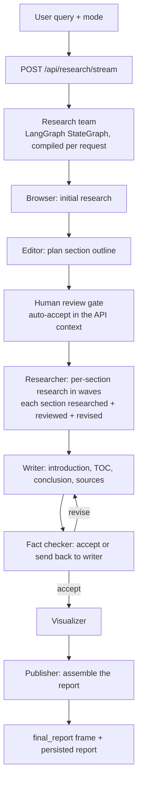

# Architecture

How the v2 system fits together — components, data flow, and the reasoning
behind the design decisions that differ from a standard RAG chatbot.

---

## Pipeline



The team is driven by `app/research/runner.py` (exposed to the route as
`app/runtime/orchestrator.py::PipelineRunner`), which streams node updates as
the graph runs. The API route (`app/api/routes.py`) translates those updates
into the frontend's NDJSON events and owns the run/session lifecycle,
persistence and replay capture.

The pipeline is first-party code under `app/research/`. It reaches the rest of
the product through exactly two seams, and calls both **directly** — there is no
patching layer:

* **Generation** — every model call goes through `app.research.llm.LLMFunnel`
  → `app.core.llm.LLMClient`, so the provider or fallback chain selected in the
  Model Control Center governs generation, and the client's circuit breakers,
  response cache, usage ledger and concurrency cap apply.
* **Retrieval** — `app/research/retrieval/base.py::SearchClientRetriever`
  delegates to `app.retrieval.client.SearchClient` (SearXNG with Wikipedia / arXiv /
  Crossref fallbacks), reusing the already-fetched page bodies.

Report sections are researched in bounded waves (`MAX_PARALLEL_AGENTS`) rather
than all at once: each wave's writers receive the titles and written drafts of
the sections already completed, so later sections do not restate earlier
findings.

---

## Answer and audit: separated by construction

The pipeline determines **what is known**; the audit layer determines **how far
it can be trusted**. The two are deliberately separate so a reader's answer can
never be contaminated by process metadata.

```text
retrieved evidence ──> pipeline ──> report markdown (the answer)
                                        +
                       audit bridge ──> fact pool ──> confidence,
                                       (deterministic)   evidence grades,
                                                        contradictions, quality
```

* **The answer** is the report the pipeline assembles: an introduction, the
  researched sections, a conclusion, an optional diagram, and references. It is
  assembled by `PublisherAgent` from the researched sections
  (`app/agents/report_agents.py`) and never carries a confidence
  number, a score, or a limitation list inside the body.
* **The fact pool** is reconstructed deterministically — no LLM — by
  `app/evidence/audit.py`, which pairs each claim-bearing sentence with the
  URL it cites and runs the retained audit core over it. Because it is cheap and
  model-free, it runs on every request.
* **The audit fields** travel beside the answer in the `final_report` frame:
  `confidence` and its `confidence_breakdown`, `quality`, `contradictions`,
  `evidence_distribution`, and `source_count`. None of them is mixed into the
  report text.

**Modes scale effort, not format.** Quick/standard/deep differ in how much
research is done — how many sections, and how many revision rounds each stage
gets. They do not switch between unrelated fixed templates: the report
structure is the same, and the section outline is derived from the question.

---

## Component map

### Research pipeline (`app/research/`)

| Module | Responsibility |
|---|---|
| `app/agents/` | The team: orchestrator (graph builder), editor/planner, section research unit + reviewer/reviser, report writer, fact checker, visualizer, publisher, plan gate, and the bounded review routing. |
| `app/research/researcher.py` | `Researcher`: one research unit — choose a role, gather evidence, write a report. |
| `app/research/skills/` | The capabilities a researcher composes: research conductor, report generator, context manager, browser/scraper manager, source curator. |
| `app/research/retrieval/` | Retriever contract, factory, and `SearchClientRetriever` (delegates to `SearchClient`). |
| `app/research/scraping/` | Page fetcher (httpx), HTML text extraction, and the anti-bot / word-list / PDF guards. |
| `app/research/context/` | BM25 lexical filtering and the document→context selection layer. |
| `app/research/prompts.py`, `config.py`, `llm.py` | Prompt families, run configuration, and the generation funnel to `LLMClient`. |
| `app/research/runner.py` | `ResearchRunner`: builds the task, compiles the graph, streams node updates, assembles the final state. |

### Runtime seam (`app/runtime/`)

| Module | Responsibility |
|---|---|
| `app/runtime/orchestrator.py` | `PipelineRunner`, the route's entry point; delegates to `app/research/runner.py`. |
| `app/runtime/event_adapter.py` | Maps pipeline node events onto the frontend's NDJSON vocabulary — including the `stage` lifecycle — and builds the terminal `final_report` frame. |
| `app/runtime/plan_review.py` | Human-in-the-loop approval handshake: the paused run waits on an `asyncio.Event`; `POST /research/{run_id}/plan` releases it. |
| `app/runtime/__init__.py` | Publishes the runtime handles (`LLMClient`, `SearchClient`) the routes read per request. |

### Retained analysis & support

| Module | Responsibility |
|---|---|
| `app/retrieval/client.py` | `SearchClient`: multi-provider retrieval (SearXNG / Wikipedia / arXiv / Crossref), circuit breakers, canonical-URL dedup, domain diversity, disk cache, page fetch. |
| `app/retrieval/searchkit/` | Search-client internals: providers, ranking, fetch, dedup, scoring and query handling. |
| `app/evidence/sources/`, `app/evidence/utils.py` | Source classification, reliability, freshness, corroboration-query building, claim/number extraction, answer-support scoring — the shared evidence vocabulary. |
| `app/evidence/audit.py` | Reconstructs the fact pool from the report + captured sources and runs the audit core over it. |
| `app/report/formatting.py` | Report markdown normalisation (tables, placeholders, duplicate headings), shared by the pipeline and the export path. |
| `app/infra/budget.py` | Per-run ceilings (model calls, wall-clock seconds) and mode multipliers. |
| `app/infra/reliability.py` | Retry / circuit-breaker / timeout primitives. |
| `app/infra/retrieval_health.py` | Run-scoped retrieval health: domain cooldowns, failed-fetch memory, telemetry. |
| `app/quality/` | Report/answer quality scoring and calibration. |
| `app/core/confidence.py` | Confidence engine: base signals + citation support + axis coverage + pool-size-scaled contradiction penalty; degraded-run cap 0.55. |
| `app/core/contradictions.py` | Three detectors (polarity, temporal, unit-aware numeric), severity ordering, cap 5. |
| `app/common/semantic.py` | TF-IDF hybrid engine: stemming, synonym canonicalization, negation weighting, vectorized batch scoring. |
| `app/core/evidence_grade.py` | Claim grading (claim→source→verification→independence→corroboration→contradiction). |

### Control & efficiency

| Module | Responsibility |
|---|---|
| `app/core/usage.py` | Per-run ledger (ContextVar): LLM calls, searches, cache hits. |
| `app/core/llm.py` + `app/core/llmkit/` | Provider resolution with circuit breakers, fail-fast auth/quota errors, Retry-After honoring (capped), JSON repair, usage parsing and provider probing; the single generation funnel for the pipeline and the retained helpers. |
| `app/core/llm_cache.py` | Exact-prompt disk cache (TTL 6h, size-capped). |
| `app/common/semantic.py` | Shared similarity engine (TF-IDF hybrid). |

### Surfaces

| Module | Responsibility |
|---|---|
| `app/api/routes.py` | NDJSON stream, resume, trace, export, sessions; provider CRUD + latency probe live in `app/api/providers_routes.py`. |
| `app/db/sqlite.py` | Auto-initialized schema (WAL), `file:`/`sqlite://` URL forms. |
| `frontend/` | React mission console: thread, answer card, claim drawer, intelligence panel, Model Control Center. |

---

## NDJSON event schema (`POST /api/research/stream`)

| Event | Payload highlights |
|---|---|
| `progress` | `request_id`, `session_id`, `message` (a live activity line) |
| `stage` | `node` (graph node), `status` (`running` / `done`), `label`. The pipeline stage lifecycle: emitted when a node STARTS and when it finishes. The live Research Workflow rail reads this, so the rail and the live trace are driven by one signal instead of the rail re-deriving progress from finished artifacts. |
| `plan` | `items` (the planned section outline) |
| `plan_review` | `run_id`, `status` (`awaiting` / `expired`), `alternatives`, `deadline_ts`. Human-in-the-loop: opens the approval card, and closes it when the review window runs out. |
| `findings` | extracted claims, with verification flags |
| `search_progress` / `search_query` | retrieval progress, never a fabricated source count |
| `critic` | `iteration`, `reason` (fact-checker revision notes) |
| `final_report` | `report` (the primary answer), `confidence`, `confidence_breakdown`, `quality`, `contradictions`, `answer_support`, `degraded`, `degraded_reasons`, `source_count` |
| `error` | `message` (actionable: key / quota / timeout causes) |

Anything the pipeline has no genuine signal for is deliberately not
fabricated; the frontend treats every event type as optional, so a clean
pipeline renders without inventing one. Every backend event type has a
matching `case` in `App.jsx` — the switch has a `default: break`, so a type
added here without one is silently dropped rather than raising.

---

## Design decisions worth knowing

**Why the pipeline is first-party.** The research pipeline lives in
`app/research/` as ordinary first-party code. There is no external research
package, no `sys.path` bootstrap, and no monkeypatched provider factory: the code
that runs a research request is code this project owns and can read end to end.

**Why the provider stack is shared, not duplicated.** The product's contract is
that the Model Control Center decides what runs. Every model call in the
pipeline goes through `LLMFunnel` → `LLMClient`, so one mechanism (active
provider or enabled chain, with its breakers/cache/ledger) governs all
generation — there is no second provider configuration to drift.

**Why retrieval is shared.** The pipeline's retriever delegates to
`SearchClient`, so web search behaves identically to the rest of the product
(SearXNG + Wikipedia/arXiv/Crossref fallbacks, the same caches and health
accounting), and page bodies fetched during retrieval are reused rather than
re-scraped.

**Why sections are researched in waves.** Sections drafted in parallel cannot
see each other, so two sections independently restate the same finding. Waves
bound how many sections run at once, and each wave's writers receive the titles
and written drafts of the sections already completed — which is what the
anti-duplication prompt instructions were always written against.

**Why the LLM cache is exact-prompt.** Semantic caching returns subtly
wrong answers to slightly different questions. Research pipelines re-issue
*identical* prompts — an exact-hit cache captures that traffic with zero
correctness risk.

**Why "not" is not a stopword.** The negation token weighted like a number
is what keeps "X" and "not X" from merging in dedup, keeps them inside the
contradiction band, and keeps citation support from counting a negation as
an affirmation. (Found by the benchmark suite, not by intuition.)

**Why MAX_PARALLEL_LLM is low.** Concurrent large prompts are exactly what
exhausts free-tier TPM/TPD quotas (observed live: Groq 200k daily tokens
burned by 3 parallel calls). The semaphore bounds in-flight prompts, not
threads.

**Why process mechanics never reach the primary answer.** "Pipeline stage",
"deterministic fallback", evidence grades, budgets and confidence floats
describe the research system, not the subject. They belong in the audit layer,
not the answer.

---

## Data lifecycles

- **Raw page content** is used during research and not persisted; the trace
  keeps snippets for transparency.
- **Facts** accumulate across research passes; dedup merges restatements and
  corroboration counts distinct domains only — self-syndication is not
  corroboration.
- **Caches**: search results 1h, LLM responses 6h, both size-capped and
  LRU-evicted.
- **SQLite**: every run persists agent events, sources, claims, evidence,
  contradictions, citations and the final report — the trace endpoint
  reconstructs the full timeline, and the verbatim NDJSON frames are stored for
  replay.
