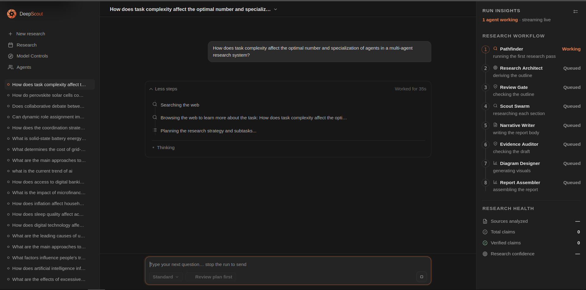
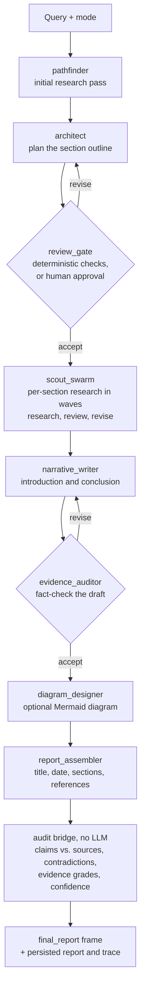

<div align="center">

<picture>
  <source media="(prefers-color-scheme: dark)" srcset="docs/assets/deepscout-branding-dark.svg">
  
</picture>

### Deep research with verifiable evidence, honest confidence, and bounded work.

[](https://github.com/AdnanZamanNiloy/deepscout/actions/workflows/tests.yml)


[Quick start](#quick-start) · [How it works](#how-it-works) · [API](#api-reference) · [Configuration](#configuration) · [Deployment](#deployment) · [Contributing](#contributing)

</div>

<p align="center">
  
</p>

DeepScout is a multi-agent research system. Give it a question and it plans a
report outline, researches each section across several search providers, writes
a cited Markdown report, and then **audits that report with deterministic
checks**: claims against the sources they cite, contradictions between sources,
per-claim evidence grades. The audit travels beside the answer, never inside it.

It is built to run on **modest hardware** (8 GB RAM, no GPU) against
**free-tier remote LLM APIs**, with no search API key, and to be more
trustworthy than a general chatbot on the things that matter for research:
evidence, contradiction handling, and confidence that reflects what actually
happened during the run.

> **Design principle:** an ungrounded answer must never be mistakable for a
> researched one. Claims carry sources, degraded runs are capped and labeled,
> and a run that cannot reach any model provider fails in seconds with the
> reason, instead of producing minutes of unusable output.

---

## Contents

- [Why DeepScout](#why-deepscout)
- [At a glance](#at-a-glance)
- [How it works](#how-it-works)
- [Quick start](#quick-start)
- [Using DeepScout](#using-deepscout)
- [API reference](#api-reference)
- [Configuration](#configuration)
- [Reliability and degradation](#reliability-and-degradation)
- [Security model](#security-model)
- [Deployment](#deployment)
- [Data model and replay](#data-model-and-replay)
- [Testing and benchmarks](#testing-and-benchmarks)
- [Known limitations](#known-limitations)
- [Troubleshooting](#troubleshooting)
- [Project layout](#project-layout)
- [Documentation map](#documentation-map)
- [Contributing](#contributing)
- [License](#license)

---

## Why DeepScout

| Principle | What it means in practice |
|---|---|
| **Answer and audit never mix** | The report is prose a person can read. Confidence, quality, contradictions and answer support travel in separate fields of the `final_report` frame, so process metadata never leaks into the answer. |
| **The audit is deterministic** | Pairing claims with the sources they cite, detecting contradictions (numeric, polarity, temporal), grading evidence and scoring confidence all run without a model call. It is cheap enough to run on every request and gives the same result for the same input. |
| **Confidence reflects what happened** | A run whose **synthesizer** fell back to deterministic extraction is capped at **0.55**, as is any run where a provider failed for transport reasons. A **summarizer** fallback is capped only when the evidence pool is genuinely weak — a verified, independently corroborated extractive pool is a blunt but real answer, and is not scored down for it. Every cap is stated in plain language beside the score (`confidence_notes`). When a run retrieved nothing usable, the audit says so instead of inventing a score. |
| **Work is bounded** | Per-run wall-clock and model-call ceilings scale with the mode. Revision loops are bounded and force-accept at their ceiling, so a stage that keeps finding fault cannot hold a request open. |
| **Fails fast and says why** | A preflight probe checks that at least one provider is reachable before any research starts. Auth, quota and timeout failures surface with an actionable message. |
| **Runs where you are** | 8 GB RAM, no GPU, no local models. Any OpenAI-compatible provider works. Provider keys are encrypted at rest. |
| **You can steer it** | Optionally pause after planning, choose among alternative outlines, edit them, and add direction before the section research begins. |
| **Everything is replayable** | The verbatim stream of every run is persisted, so a finished run can be replayed, traced and exported without re-running anything. |

---

## At a glance

| | |
|---|---|
| **Backend** | Python 3.10+, FastAPI, LangGraph 1.x, httpx, aiosqlite, pydantic-settings |
| **Frontend** | React 18, Vite 5, Mermaid (diagrams render as figures) |
| **Models** | Any OpenAI-compatible `/chat/completions` host: a single provider or an ordered fallback chain, configured in the app |
| **Search** | Self-hosted [SearXNG](https://github.com/searxng/searxng) plus Wikipedia, arXiv and Crossref. No search API key. |
| **Modes** | `quick` · `standard` · `deep` (research breadth and revision rounds, not report shape) |
| **Output** | Cited Markdown report plus audit fields; export to Markdown, DOCX or PDF |
| **Streaming** | NDJSON over a single HTTP response |
| **Persistence** | SQLite (WAL), schema created automatically |
| **Tests** | 672 backend and 353 frontend tests, all offline; backend suite runs in CI on every push and pull request |

---

## How it works

One LangGraph state machine is compiled per request. Two conditional edges
loop, and both are bounded by the run's mode.



| Stage | Shown in the UI as | What it does |
|---|---|---|
| `pathfinder` | Searching the web | First research pass: search, read, write an initial report. |
| `architect` | Planning the outline | Derives the section outline from that pass and keeps the first *N* sections for the mode. |
| `review_gate` | Reviewing the plan | Deterministic structural checks, or a human approval when interactive review is on. Can send the outline back. |
| `scout_swarm` | Researching each section | Researches sections in bounded waves (`MAX_PARALLEL_AGENTS`). Each section runs research, review and revise, and each wave sees the drafts already written so later sections do not repeat earlier ones. |
| `narrative_writer` | Writing the report | Writes the introduction and conclusion around the researched sections. |
| `evidence_auditor` | Checking the facts | Reviews the assembled draft and either accepts it or returns notes that send it back to the writer. |
| `diagram_designer` | Generating visuals | Optionally adds a Mermaid diagram. |
| `report_assembler` | Assembling the report | Compiles title, run date, sections, conclusion and references. |

After the graph finishes, the **audit bridge** (`app/evidence/audit.py`)
rebuilds a fact pool from the report's own citations and the sources the run
actually retrieved, then runs confidence, contradiction, evidence-grade and
quality scoring over it. It is guarded end to end: a failure yields fewer audit
fields, never a broken run.

**Two seams connect the pipeline to the rest of the product.** Every model call
goes through one generation funnel (`LLMFunnel` → `LLMClient`), so the provider
or fallback chain chosen in Model Controls governs everything, with the same
circuit breakers, response cache and usage ledger. Every search goes through
`SearchClient`, so retrieval behaves identically everywhere and page bodies
fetched during retrieval are reused rather than re-scraped.

**Report quality safeguards** built into the pipeline: duplicate Introduction
and Conclusion headings are collapsed, a source-relevance gate drops pages that
engage nothing in the report's subject, references must name a specific
publication (placeholder authors are stripped), and the report is dated with the
actual run date rather than the model's guess.

Full component map, event schema and design rationale: [`ARCHITECTURE.md`](ARCHITECTURE.md).

---

## Quick start

**Requirements:** Python 3.10+ (CI runs 3.12), Node 18+, git, 8 GB RAM, internet
access, and an API key for any OpenAI-compatible LLM provider (Groq's free tier
is a common starting point). No GPU, no local models, no search API key.

### 1. Start the backend

```bash
git clone https://github.com/AdnanZamanNiloy/deepscout.git
cd deepscout

python3 -m venv .venv
source .venv/bin/activate              # Windows: .venv\Scripts\activate
pip install -r backend/requirements.txt

cd backend
python -m uvicorn main:app --host 127.0.0.1 --port 8000 --reload
```

No `.env` is required, and **no API keys go in it**. Check that it is up:

```bash
curl -s http://127.0.0.1:8000/api/health
# {"status":"ok","searxng":{"url":"http://localhost:8080","managed":false}}
```

The `searxng` block tells you whether this process started SearXNG itself
(`managed: true`), found an existing instance, or has none (search then falls
back to Wikipedia, arXiv and Crossref).

### 2. Start the frontend

```bash
cd frontend
npm install
npm run dev                            # http://127.0.0.1:5173
```

The dev server proxies `/api` to `127.0.0.1:8000`.

### 3. Add a model provider

Open **Model Controls** (`http://127.0.0.1:5173/#/model-controls`), add a
provider with a name, base URL, API key and model id, then select it. Any host
serving `/chat/completions` works: OpenAI, Groq, Together, OpenRouter, or a
local vLLM / LM Studio / Ollama endpoint. The key is encrypted at rest, takes
effect on the next call with **no restart**, and a selected provider is
exclusive, so no other key is spent.

<details>
<summary><b>Headless alternative: the API or environment variables</b></summary>

Using the API:

```bash
curl -X POST http://127.0.0.1:8000/api/providers \
  -H "Content-Type: application/json" \
  -d '{"name":"OpenRouter","base_url":"https://openrouter.ai/api/v1","api_key":"sk-...","model":"meta-llama/llama-3.1-8b-instruct:free"}'

curl -X POST http://127.0.0.1:8000/api/providers/1/active
curl -X POST http://127.0.0.1:8000/api/providers/1/test -H "Content-Type: application/json" -d '{}'
```

API responses never include the key, only a masked `key_hint`.

Using environment variables (all optional; `backend/.env.example` ships them
commented out):

```bash
cp backend/.env.example backend/.env   # then uncomment what you need
```

```env
GROQ_API_KEY=...                       # model: openai/gpt-oss-20b
HUGGINGFACE_API_KEY=...
# or any OpenAI-compatible host (all three required together):
# CUSTOM_LLM_API_KEY=...
# CUSTOM_LLM_BASE_URL=https://...
# CUSTOM_LLM_MODEL=...
```

With nothing set in the environment, the order is custom provider → Groq →
Hugging Face. A provider selected in the UI always wins over these.

</details>

### 4. Add general web search (optional, one-time)

Wikipedia, arXiv and Crossref work with nothing installed. SearXNG adds general
web search, and **the backend starts and stops it for you** (`SEARXNG_AUTOSTART`,
on by default) once a local clone exists:

```bash
# from the repository root; clone to <repo>/searxng, or set SEARXNG_HOME
git clone https://github.com/searxng/searxng.git searxng
cd searxng
python3 -m venv .venv && .venv/bin/pip install -U -r requirements.txt

cp settings.yml settings.local.yml
# edit settings.local.yml:
#   server.secret_key: "<any long random string>"
#   search.formats: add "json"   (DeepScout queries /search?format=json)
```

SearXNG must run in **its own** virtualenv (point `SEARXNG_PYTHON` at it if it
is not at `searxng/.venv/bin/python`) and listens on `127.0.0.1:8080`. If it
never comes up, runs still work on the three direct providers.

### 5. Run your first research

In the UI, ask a question. Or stream it from the command line:

```bash
curl -N -X POST http://127.0.0.1:8000/api/research/stream \
  -H "Content-Type: application/json" \
  -d '{"query": "What is the evidence that retrieval augmented generation reduces hallucinations?", "mode": "standard"}'
```

Each line of the response is one JSON event; see the [API reference](#api-reference).

### Just want to look around?

Open `http://127.0.0.1:5173/?demo=1` to run the real console against **real
recorded runs**: five finished research runs with their actual questions,
progress, confidence, claims and reports, with no backend and no model calls. The
fixtures are generated from real recordings by `backend/bench/make_demo_fixtures.py`, so
they cannot describe a pipeline that no longer runs. The same mode powers the
[static demo deployment](#static-demo-cloudflare-pages).

---

## Using DeepScout

### Modes

Select the mode in the composer, or send `"mode"` in the request. A mode sets
**how much research a run does**, not the shape of the report or its audit.

| Mode | Report sections | Plan revisions | Draft revisions | Fact-check revisions | Call and time ceilings¹ | Typical run | Use for |
|---|---|---|---|---|---|---|---|
| `quick` | 3 | 1 | 1 | **0** | 21 calls · 180 s | ~2 min | Fast lookups |
| `standard` (default) | 5 | 2 | 2 | 1 | 60 calls · 360 s | ~3.5 min | Normal research |
| `deep` | 8 | 2 | 2 | 1 | 150 calls · 720 s | ~5 min | Multi-angle investigations |

¹ The ceilings are `MAX_LLM_CALLS` (60) scaled by 0.35 / 1.0 / 2.5, and the
per-mode wall-clock caps in `MODE_HARD_CAP_SECONDS` — the point at which a run
is stopped, set well above a healthy run so a stalled provider is caught rather
than a real one. `RESEARCH_TIMEOUT_SEC` (1000 s) can only lower them. "Typical
run" is the measured median, and is what the mode picker shows. An unknown mode
falls back to `standard`.

`quick` differs from the others in more than size: it runs a **single pass**,
with no fact-check revision round and no figure, because both were the round
that pushed it from ~100 s to 132-175 s. A standing fact-check objection is
still reported — it just does not buy a rewrite.

### Interactive plan review (human in the loop)

Turn it on per request with `"hitl": true`, or for a whole deployment with
`PLAN_REVIEW_INTERACTIVE=true`. After planning, the run pauses and the UI shows
an approval card with up to `PLAN_REVIEW_ALTERNATIVES` (default 3) candidate
outlines. You can approve one, edit its sections, add free-text direction
("focus on costs and policy implications"), or send it back to the planner. If
nobody answers within `PLAN_REVIEW_TIMEOUT_SEC` (default 300 s) the run
continues with automatic approval, and the card shows a live countdown to the
real deadline. The decision is delivered with `POST /api/research/{run_id}/plan`.

### Sessions and conversations

A chat is a first-class **session**, not a pile of unrelated runs.

- **Stable session id.** One id per chat, created on first use and reused by every
  follow-up. Only **New Chat** mints a new one.
- **Append-only history.** Opening a chat restores the complete ordered thread
  and each run's pipeline steps without re-fetching anything.
- **Stable title.** A chat is named by its first message; follow-ups never rename it.
- **Interrupt and edit.** Stop a streaming response cleanly (the run is recorded
  as `cancelled` and no partial report is persisted), edit an earlier message and
  resend. The thread truncates from that turn and the new request runs in the
  same session with no state left over from the interrupted one.

### Export

Download any completed report as Markdown, DOCX or PDF from the export menu, or
via `GET /api/research/{run_id}/export/{md|docx|pdf}`. Exports render from the
persisted report and stored citations, never from UI text. PDF export uses
WeasyPrint, which needs the pango and cairo system libraries on the host.

### Resume

`POST /api/research/{run_id}/resume` retries a run whose status is `failed` or
`timeout`. **The pipeline checkpoints its state after every node**, so a resume
restores that state and skips the nodes already done — an interrupted run does
not re-pay for the search and model calls it already made. Run identity and the
NDJSON contract are preserved. A user-cancelled run is deliberately not
resumable, and a run that already has a final report returns `409`.

Resume reopens the stages a pending objection still needs: if the last thing to
happen was a rejection the consumer has not seen, that pair runs again rather
than the run looping on the rejection it already recorded.

### Local documents

Besides the web, the pipeline can read your own files: set
`RESEARCH_REPORT_SOURCE` to `local` or `hybrid` and point `RESEARCH_DOC_PATH` at
a directory. See [`CONFIG.md`](CONFIG.md).

### The console

A hash-routed React console with light and dark themes and six views:

| View | Route | Purpose |
|---|---|---|
| Landing | `/#/` | Product overview |
| Workspace | `/#/workspace` | The chat: thread, live pipeline trace, answer card, claim drawer, Run Insights rail |
| Research | `/#/missions` | Past runs with replay |
| Agents | `/#/agents` | The pipeline roster |
| Model Controls | `/#/model-controls` | Providers, fallback chains, serving mode (legacy `/#/providers` still resolves here) |
| Docs | `/#/docs` | Built-in documentation site |

---

## API reference

Base path `/api`. FastAPI serves interactive OpenAPI docs from the backend at
`http://127.0.0.1:8000/docs`.
`POST /research/stream` and `POST /research/{run_id}/resume` are rate-limited
per client IP by `RATE_LIMIT` (default `5/minute`) and return `429` beyond it.

### Endpoints

| Method | Path | Purpose |
|---|---|---|
| `GET` | `/health` | Liveness, plus SearXNG status |
| `POST` | `/research/stream` | Run research; streams NDJSON events |
| `POST` | `/research/{run_id}/plan` | Deliver a plan-review decision to a paused run |
| `POST` | `/research/{run_id}/resume` | Re-run a failed or timed-out run |
| `GET` | `/research/{run_id}/trace` | Full persisted reconstruction of a run |
| `GET` | `/research/{run_id}/export/{fmt}` | Export the report as `md`, `docx` or `pdf` |
| `GET` | `/sessions` | List chat sessions (one row per chat) |
| `GET` | `/sessions/{session_id}` | Full ordered chat history |
| `GET` `POST` | `/providers` | List (keys masked) or add a provider |
| `PUT` `DELETE` | `/providers/{provider_id}` | Update or delete a provider |
| `POST` | `/providers/{provider_id}/active` | Select a provider (exclusive) |
| `POST` | `/providers/active/clear` | Clear the selected provider |
| `POST` | `/providers/{provider_id}/test` | Probe a provider's reachability and latency |
| `GET` `POST` | `/provider-chains` | List or create fallback chains |
| `PUT` `DELETE` | `/provider-chains/{chain_id}` | Rename or delete a chain |
| `PUT` | `/provider-chains/{chain_id}/members` | Set the chain's ordered members (first is primary) |
| `POST` | `/provider-chains/{chain_id}/reorder` | Reorder members |
| `POST` | `/provider-chains/{chain_id}/enabled` | Enable or disable a chain |
| `POST` | `/provider-chains/clear` | Disable all chains |

Error responses are plain JSON `{"detail": "..."}`: `404` unknown run, `409` run
has no completed report or is not resumable, `422` unsupported export format or an invalid request body (for example a query over
500 characters), `429` rate limit.

### Request body for `POST /research/stream`

| Field | Type | Default | Notes |
|---|---|---|---|
| `query` | string | required | 1 to 500 characters |
| `mode` | string | `"standard"` | `quick`, `standard` or `deep`; unknown values fall back to `standard` |
| `session_id` | string | generated | Reuse it to append to an existing chat |
| `hitl` | boolean | deployment default | Opt in to interactive plan review for this run |
| `deep_research` | boolean | `false` | Accepted for compatibility; has no effect. Use `mode`. |

### Stream events

The response is `application/x-ndjson`: one JSON object per line, each with a
`type` and a millisecond `ts`. Exactly these types are emitted:

| `type` | Payload highlights |
|---|---|
| `progress` | `request_id`, `session_id`, `message`: a live activity line |
| `stage` | `node`, `status` (`running` or `done`), `label`: a pipeline node starting or finishing. The live rail and the trace are both driven by this one signal. |
| `plan` | `items`: the planned section outline |
| `plan_review` | `status` (`awaiting` or `expired`), `run_id`, `alternatives`, `deadline_ts`: opens the approval card and closes it when the window ends |
| `critic` | `iteration`, `reason`: the fact-checker's revision notes |
| `findings` | `items`: the extracted claims, each with its source, verification verdict and challenge flag. Emitted once at the end of a run, so the live panel shows the same claim counts a replay does. |
| `final_report` | The report and its audit fields (below) |
| `error` | `message`: actionable, naming the key, quota or timeout cause |

A typical run, abridged:

```jsonl
{"type":"progress","message":"Query received","request_id":"…","session_id":"…","ts":…}
{"type":"stage","node":"pathfinder","status":"running","label":"Searching the web","ts":…}
{"type":"stage","node":"pathfinder","status":"done","label":"Searching the web","ts":…}
{"type":"plan","items":["…","…","…"],"ts":…}
{"type":"stage","node":"scout_swarm","status":"running","label":"Researching each section","ts":…}
…
{"type":"final_report","report":"# …","confidence":…,"source_count":…,"ts":…}
```

### The `final_report` frame

| Field | Type | Meaning |
|---|---|---|
| `report` | string (Markdown) | **The answer**: introduction, researched sections, conclusion, optional Mermaid diagram, references. No scores or limitation lists inside the body. |
| `confidence` | float, 0 to 1 | Multi-signal score over ten signals: source quality and diversity, citation coverage and support, claim verification, cross-source agreement, freshness, critic survival, evidence grade, axis coverage, less a pool-size-scaled contradiction penalty. Capped on degraded runs. |
| `confidence_breakdown` | object | Every signal's measured value for this run |
| `confidence_notes` | array | How the score was reached: signals that could not be measured, and any cap applied |
| `quality` | object | Report quality assessment |
| `contradictions` | array | Detected conflicts (numeric, polarity or temporal), severity-ordered, at most 5 |
| `answer_support` | float or null | Share of the report's cited sentences supported by the source they cite |
| `degraded`, `degraded_reasons` | array, object | Which stages fell back, and why |
| `source_count` | integer | Distinct source URLs the run gathered |

A few further fields (`audit`, `citation_health`, `provider_degraded`,
`provider_kinds`, `wave_report`) are kept for client compatibility and may be
empty. When a run produced no usable evidence, audit fields are empty rather than
invented.

### Consuming the stream from Python

```python
import json
import httpx

URL = "http://127.0.0.1:8000/api/research/stream"
payload = {"query": "What is retrieval augmented generation?", "mode": "quick"}

with httpx.stream("POST", URL, json=payload, timeout=None) as response:
    response.raise_for_status()
    for line in response.iter_lines():
        if not line:
            continue
        event = json.loads(line)
        kind = event["type"]
        if kind == "stage":
            print(f"[{event['status']:>7}] {event['label']}")
        elif kind == "final_report":
            print(event["report"])
            print("confidence:", event.get("confidence"), "| sources:", event.get("source_count"))
        elif kind == "error":
            print("error:", event["message"])
```

Clients should treat every event type as optional and ignore types they do not
recognize.

---

## Configuration

Every setting goes through `app/common/config.py` (`pydantic-settings`), which
is the single source of truth, and is documented in `backend/.env.example` and
[`CONFIG.md`](CONFIG.md). Real environment variables override `backend/.env`,
which overrides `backend/.env.example`. Nothing is required.

<details open>
<summary><b>Run limits and concurrency</b></summary>

| Setting | Default | Purpose |
|---|---|---|
| `RESEARCH_TIMEOUT_SEC` | `1000` | Hard wall-clock ceiling on one request |
| `MAX_RESEARCH_SECONDS` | `300` | Per-run wall-clock budget (scaled by mode) |
| `MAX_LLM_CALLS` | `60` | Per-run model-call budget (scaled by mode) |
| `MAX_ITERATIONS` | `3` | Upper bound on planned research iterations |
| `MAX_PARALLEL_AGENTS` | `3` | Wave size for section research |
| `MAX_PARALLEL_LLM` | `4` | Concurrent model calls. Lower it on a strict free tier; raise it on a paid or large-context endpoint. |
| `MAX_PARALLEL_SEARCH` / `MAX_PARALLEL_FETCH` | `3` / `4` | Concurrent searches and page fetches |
| `RATE_LIMIT` | `5/minute` | Per-client limit on research requests |
| `PLAN_REVIEW_INTERACTIVE` | `false` | Pause for human plan review by default |
| `PLAN_REVIEW_TIMEOUT_SEC` | `300` | Wait before auto-approving |
| `PLAN_REVIEW_ALTERNATIVES` | `3` | Candidate outlines offered |

</details>

<details>
<summary><b>Models and providers</b></summary>

| Setting | Default | Purpose |
|---|---|---|
| `LLM_TIMEOUT_SEC` | `60` class / `25` shipped | Per-call timeout (Groq, Hugging Face). The shipped `.env.example` lowers it to 25 s, which is what a fresh clone runs with. |
| `CUSTOM_LLM_TIMEOUT_SEC` | `60` class / `90` shipped | Per-call timeout for the custom provider, which is often slower and needs the longer value. |
| `LLM_TEMPERATURE` | `0.3` | Sampling temperature (a provider row may override it) |
| `LLM_BREAKER_THRESHOLD` | `3` | Consecutive failures that open a provider's circuit breaker |
| `LLM_BREAKER_COOLDOWN_SEC` | `15` | How long an open breaker stays open |
| `LLM_CACHE_ENABLED` / `LLM_CACHE_TTL_SEC` | `true` / `21600` | Exact-prompt response cache, 6 hour TTL |
| `PROVIDER_CHAINS_ENABLED` | `true` | Kill switch for fallback chains |
| `ACTIVE_PROVIDER_FALLBACK` | `false` class / `true` shipped | Let a failing selected provider fall through to the env chain. `false` is strict: no other key is spent without your say-so. The shipped `.env.example` enables the fallback. |
| `DEEPSCOUT_SECRET_KEY` | unset | Encrypts provider keys at rest; falls back to an auto-created `backend/.deepscout_secret` (`0600`) |
| `GROQ_MODEL` | `openai/gpt-oss-20b` | Model for the env-configured Groq provider |
| `HUGGINGFACE_MODEL` | `Qwen/Qwen2.5-7B-Instruct` | Model for the env-configured Hugging Face provider |

</details>

<details>
<summary><b>Retrieval and SearXNG</b></summary>

| Setting | Default | Purpose |
|---|---|---|
| `SEARXNG_ENABLED` | `true` | `false` skips SearXNG entirely |
| `SEARXNG_AUTOSTART` | `true` | The backend spawns and stops SearXNG itself |
| `SEARXNG_URL` | `http://localhost:8080` | Where SearXNG listens |
| `SEARXNG_HOME` / `SEARXNG_PYTHON` | `<repo>/searxng` / its `.venv` | Clone location and its own interpreter |
| `SEARXNG_STARTUP_TIMEOUT_SEC` | `45` | How long startup waits for `/healthz` before degrading |
| `SEARXNG_CATEGORIES` | `general,science` | SearXNG categories queried |
| `SEARCH_TIMEOUT_SEC` | `20` | Per-search timeout |
| `SEARCH_DOMAIN_COOLDOWN_SEC` | `90` | How long a repeatedly failing domain is skipped |
| `RESEARCH_MAX_RESULTS_PER_QUERY` | `5` | Results per search query |
| `CACHE_SIZE_LIMIT_BYTES` / `CACHE_TTL_SEC` | `250000000` / `3600` | Search cache: 250 MB cap, 1 hour TTL |

</details>

<details>
<summary><b>Report, storage and safety</b></summary>

| Setting | Default | Purpose |
|---|---|---|
| `DATABASE_URL` | `./research.db` | SQLite path (`file:` and `sqlite://` forms accepted) |
| `RESEARCH_TOTAL_WORDS` | `1200` | Target report length |
| `RESEARCH_REPORT_FORMAT` | `APA` | Citation format named in the prompts |
| `RESEARCH_LANGUAGE` | `english` | Output language |
| `RESEARCH_REPORT_SOURCE` | `web` | `web`, `local` or `hybrid` |
| `RESEARCH_DOC_PATH` | `./my-docs` | Directory read when the source is `local` or `hybrid` |
| `RESEARCH_CONTEXT_FILTER` | `auto` | `auto`, `keyword` (local BM25, no model) or `none` |
| `ALLOW_PRIVATE_URLS` | `false` | **Disables the SSRF and local-file guard.** Enable only deliberately. |

</details>

---

## Reliability and degradation

DeepScout assumes remote, rate-limited, occasionally unavailable providers, and
is designed so that trouble degrades quality visibly instead of crashing or
hanging.

| Concern | Behavior |
|---|---|
| **Provider unreachable** | A preflight probe runs before research starts. With no reachable provider the run fails in seconds, listing per-provider reasons. |
| **Provider failures mid-run** | Auth and quota errors fail fast instead of burning retries. `Retry-After` is honored but capped. After `LLM_BREAKER_THRESHOLD` (3) consecutive failures a provider's circuit breaker opens for `LLM_BREAKER_COOLDOWN_SEC` (15 s). |
| **Provider selection** | A provider selected in the UI is exclusive. An enabled fallback chain replaces single-provider selection entirely (the two modes are mutually exclusive by construction). With neither, the order is custom provider → Groq → Hugging Face. |
| **Model returns nothing useful** | Structured (JSON) model calls fail soft to an empty result instead of raising. The report writer has deterministic fallbacks for the introduction and conclusion. The run is flagged `degraded` and its confidence is capped at 0.55. |
| **Runaway work** | Wall-clock and model-call ceilings per run (scaled by mode), a hard request timeout, bounded revision loops that force-accept at their ceiling, and concurrency caps on LLM calls, searches, fetches and agents. |
| **Search trouble** | If SearXNG is down, retrieval continues on Wikipedia, arXiv and Crossref. Failing domains are cooled down, failed URLs are remembered for the run, results are deduplicated by canonical URL and diversified by domain, and searches are cached on disk. |
| **Audit trouble** | The audit bridge is total and fail-safe: a failing step yields fewer audit fields and a logged warning, never a broken run. |
| **Memory** | Built for an 8 GB host: disk caches are size-capped and LRU-evicted, and raw page bodies are used during research and not persisted (the trace keeps snippets). |
| **Schema changes** | Additive and idempotent (`CREATE TABLE IF NOT EXISTS`, guarded `ALTER`), applied automatically at startup, so existing data and readers keep working. |

Every degradation is recorded and streamed. A degraded report is visibly marked
in the UI, never presented as a clean one.

---

## Security model

DeepScout is designed as a **single-user or small-trusted-team tool**. Know what
it protects and what it leaves to you.

**Built in**

- **Encrypted provider keys.** API keys are encrypted at rest with Fernet. The
  secret comes from `DEEPSCOUT_SECRET_KEY` or an auto-created
  `backend/.deepscout_secret` (mode `0600`). The API only ever returns a masked
  `key_hint`. If the secret is lost, stored keys cannot be decrypted and must be
  re-entered, so back it up alongside the database.
- **SSRF and local-file guard.** Every URL the pipeline is about to fetch is
  validated before a socket opens: only `http` and `https`, DNS is resolved, and
  any address that is private, loopback, link-local (including cloud metadata),
  reserved, multicast or unspecified is rejected, as is any host that does not
  resolve. `ALLOW_PRIVATE_URLS=true` opts out of the address check only, never
  the scheme check.
- **Rate limiting** of research requests per client IP (`RATE_LIMIT`).
- **Bounded input**, for example queries are capped at 500 characters.
- **Locked-down CORS.** Only `http://127.0.0.1:5173` and `http://localhost:5173`
  (the Vite dev server) are allowed origins.
- **Secret hygiene.** `.env`, `*.db` and `.deepscout_secret` are gitignored.

**Not built in**

- **There is no inbound authentication.** Anyone who can reach the API can run
  research on your provider quota and can add, switch or delete providers.
  There is also no multi-tenancy, and no TLS (terminate it at a proxy).
  **Keep the backend bound to `127.0.0.1`** (as in the commands above) and put
  authentication in front of anything wider. See [Deployment](#deployment).

**Reporting a vulnerability.** Please do not open a public issue. Use the
repository's **Security** tab to report it privately, or contact the maintainer
through their GitHub profile.

---

## Deployment

There is no Docker image or process manager configuration in this repository.
These are the supported shapes.

### Local (development and personal use)

The [Quick start](#quick-start) is the whole story. One `uvicorn` process serves
the API and manages SearXNG; the Vite dev server serves the UI.

### Single host behind a reverse proxy

Build the UI and serve it from the same origin as `/api`, with authentication and
TLS at the proxy:

```bash
cd frontend && npm run build          # outputs frontend/dist
cd ../backend && python -m uvicorn main:app --host 127.0.0.1 --port 8000
```

An illustrative nginx server block (adapt paths, names and TLS to your host):

```nginx
server {
    listen 443 ssl;
    server_name research.example.com;

    auth_basic           "DeepScout";                       # or your SSO / OIDC proxy
    auth_basic_user_file /etc/nginx/deepscout.htpasswd;

    root /srv/deepscout/frontend/dist;
    index index.html;
    location / { try_files $uri /index.html; }              # docs.html is a real file and is served directly

    location /api/ {
        proxy_pass          http://127.0.0.1:8000;
        proxy_http_version  1.1;
        proxy_set_header    Host $host;
        proxy_set_header    X-Forwarded-For $remote_addr;   # so RATE_LIMIT sees real client IPs
        proxy_buffering     off;                            # NDJSON must stream, not buffer
        proxy_read_timeout  1100s;                          # longer than RESEARCH_TIMEOUT_SEC (1000)
    }
}
```

Operational notes:

- **Run one worker process.** Plan review is an in-process handshake, state lives
  in a single SQLite file, and the rate limiter is in-memory, so scale up the
  host rather than the worker count.
- **Health checks.** `GET /api/health` is a cheap liveness probe.
- **Logs** are structured JSON lines on stdout (`structlog`).
- **Backups.** Copy the database with SQLite's online backup, and keep the secret
  file with it:

  ```bash
  sqlite3 research.db ".backup research.backup.db"
  cp backend/.deepscout_secret /safe/place/
  ```
- **Upgrades.** `git pull`, `pip install -r backend/requirements.txt`, restart.
  Schema changes apply automatically and additively.
- **Caches** live in a gitignored `.cache/` directory next to the database and are
  size-capped, so they are safe to delete at any time.

### Static demo (Cloudflare Pages)

The landing page, docs site and console can be deployed as a static site with no
backend, replaying scripted research conversations from fixtures. Demo mode is
opt-in at build time (`VITE_DEMO=1`) and never changes the production app.

```bash
bash deploy/cloudflare-pages/build.sh                                  # produces frontend/dist
npx wrangler pages deploy frontend/dist --project-name deepscout-demo
```

The repo-root `package.json` and `wrangler.jsonc` let Cloudflare's Workers and
Pages build runners install and serve the frontend. Full instructions, including
connecting the repository from the dashboard, are in
[`deploy/cloudflare-pages/README.md`](deploy/cloudflare-pages/README.md).

---

## Data model and replay

Every run persists an auditable trace in SQLite, joinable by `run_id`.

| Group | Tables |
|---|---|
| Run record | `research_runs`, `research_reports`, `final_reports` |
| Evidence trail | `sources`, `claims`, `evidence`, `contradictions`, `citations`, `verification_results` |
| Execution | `agent_tasks`, `agent_events`, `critic_reviews`, `decisions` |
| Replay and chats | `run_trace_frames` (the verbatim NDJSON stream), `sessions` |
| Configuration | `llm_providers`, `provider_chains`, `provider_chain_members`, `schema_version` |

- **Trace.** `GET /api/research/{run_id}/trace` reconstructs the run: plan,
  sources, claims with verification flags, node events, contradictions,
  citations and the final report.
- **Replay.** Because the exact frames are stored, selecting a chat in the UI
  restores its complete history and per-run pipeline steps with no re-fetch.
- **Export** renders from the same canonical data as the trace.

---

## Testing and benchmarks

```bash
# Backend, from backend/
pytest tests/ -q                       # 672 tests, all offline
ruff check app tests bench             # lint
mypy app                               # informational baseline, not enforced

# Frontend, from frontend/
npm test                               # 353 tests on Node's built-in runner, no extra deps
npm run build                          # production build
```

Every backend test runs without network access or API keys: HTTP is mocked, the
LLM cache is force-disabled, provider keys are pinned to dummies, and the
provider store is isolated from your real database. CI runs the backend suite on
Python 3.12 for every push and pull request; run lint and the frontend suite
locally before you submit a change.

### Benchmarks

The offline suite is deterministic and network-free. It measures the audit
components on **hand-labeled fixtures** (`backend/bench/datasets.py`), and the
labeled sets are small, so treat the numbers as regression gates rather than as
claims about real-world accuracy. Reproduce them with
`python bench/run_offline.py` from `backend/`.

| Component | Result on the labeled fixtures |
|---|---|
| Citation support | Sentence accuracy 1.00, numeric grounding 1.00 |
| Contradiction detection | Precision 1.00, recall 1.00 across numeric, polarity and temporal kinds |
| Confidence calibration | 100% of cases in the expected band, ordering monotonic |
| Semantic engine | Spearman 0.71 against human labels; dedup precision 1.00, recall 0.60, F1 0.75 at the 0.86 threshold |
| LLM response cache | 66% hit ratio on a repeat-heavy workload; repeat passes are served from disk, hundreds of times faster (timing-dependent) |

Latency and peak-memory figures are in
[`BENCHMARK_RESULTS.md`](backend/bench/results/BENCHMARK_RESULTS.md) and
[`benchmark_results.json`](backend/bench/results/benchmark_results.json).

Threshold-gated evaluators, which fail the run when a metric drops below its
golden threshold (run from `backend/`; they write results into `bench/results/`):

| Command | What it gates |
|---|---|
| `python bench/eval_contradictions.py` | Contradiction detection and resolution against `bench/golden/contradictions_v1.json` |
| `python bench/eval_provider.py` | Provider-failure classification: a provider outage is never read as weak evidence, and a transient 429 does not open the breaker |
| `python bench/eval_retrieval.py` | Retrieval health under scripted 403, 429 and timeout outcomes: fetch success, cooldown skips, primary-source acquisition |
| `python bench/live_retrieval_check.py` | Not a gate: a small, bounded **live** retrieval check with no LLM calls, for before-and-after comparison of search changes |

`bench/eval_report_quality.py` is a scoring library rather than a command: it grades a
report per query type on a 0 to 10 scale for groundedness, coverage and numeric
accuracy.

---

## Known limitations

Stated plainly, so you can decide where DeepScout fits.

- **No authentication or multi-tenancy.** See [Security model](#security-model).
- **The audit is lexical and sentence-level.** Claims are extracted by sentence
  splitting and citation attribution, and similarity is a CPU-light TF-IDF hybrid
  with stemming, synonym canonicalization and negation weighting. It catches
  fabricated numbers, negation inversions and topical mismatches, but it does not
  understand paraphrase at an embedding level (dedup recall is 0.60 on the labeled
  set, with precision 1.00: it never merges what it should not, but it misses some
  restatements). This is a deliberate trade for the 8 GB, no-GPU target.
- **Report quality depends on the model you attach.** The offline benchmarks cover
  the deterministic components, not live model wording. Small free-tier models are
  slower and less reliable than larger ones, and a rate-limited provider will
  degrade a run.
- **Resume replays the last incomplete stretch, not the whole run.** State is
  checkpointed per node, but the graph restarts from its entry point and
  skips completed nodes; a stage whose output is lost is re-run.
- **No cost accounting.** Token usage is recorded for observability, but nothing
  prices or caps spend. Bounds are on model calls and wall-clock time.
- **SearXNG is a separate install.** It needs a local clone, its own virtualenv,
  and `json` enabled in its `search.formats`. Without it, search is limited to
  Wikipedia, arXiv and Crossref.
- **PDF export needs system libraries** (pango and cairo for WeasyPrint) that a bare
  host may lack even when the Python package installed.
- **English by default.** `RESEARCH_LANGUAGE` is configurable, but the deterministic
  audit's vocabulary (negation, polarity, synonyms) is tuned for English.
- **Single process.** See the deployment notes.
- **Frontend bundle size.** The production build emits chunks over 900 kB
  (Mermaid and its diagram engines), which Vite warns about.

---

## Troubleshooting

<details>
<summary><b>"No LLM provider configured" or "No LLM provider is reachable right now"</b></summary>

The first means no provider exists yet, which is expected on a fresh install: add
and select one in Model Controls (no restart needed). The second means providers
exist but all failed the preflight probe, and the error lists per-provider
reasons. Usual causes: an exhausted free-tier daily quota (resets daily), a wrong
key (401), or a slow custom endpoint (raise `CUSTOM_LLM_TIMEOUT_SEC`). Use the
provider's **test** button or `POST /api/providers/{id}/test` to see latency and
the failure reason.

</details>

<details>
<summary><b>Search returns nothing, or only Wikipedia</b></summary>

SearXNG is not running or is unreachable. Check `GET /api/health` (the `searxng`
block), then query it directly:

```bash
curl -s "http://localhost:8080/search?q=test&format=json" | head -c 200
```

A `403` usually means `json` is not enabled in `search.formats`. A `500` or empty
body means the service is down or `server.secret_key` is missing. Meanwhile, runs
continue on Wikipedia, arXiv and Crossref. Some SearXNG engines report "too many
requests"; that is normal, and the circuit breaker waits
`SEARCH_SEARXNG_COOLDOWN_SEC` while the healthy engines still answer.

</details>

<details>
<summary><b>Runs feel slow, or a free tier runs out of tokens</b></summary>

The first run of a query pays full search and model latency; re-runs hit the disk
caches (search: 1 hour, model prompts: 6 hours). `deep` mode researches 8 sections
in waves; use `standard` for interactive work. Lower `MAX_PARALLEL_LLM` on a strict
free tier, where a few parallel large prompts can exhaust the daily token limit.

</details>

<details>
<summary><b>The stream stops or is cut off behind a proxy</b></summary>

Disable response buffering for `/api/` (`proxy_buffering off` in nginx) and set the
read timeout above `RESEARCH_TIMEOUT_SEC` (1000 s by default).

</details>

<details>
<summary><b>Groq returns 404 for the model</b></summary>

Models get decommissioned. Set `GROQ_MODEL` (or the model in Model Controls) to a
current one from the Groq console. This only applies if you configured Groq
through the environment.

</details>

<details>
<summary><b>"Database is locked"</b></summary>

Make sure only one backend process uses the same `research.db`.

</details>

<details>
<summary><b>PDF export fails</b></summary>

Install the pango and cairo system libraries that WeasyPrint needs. Markdown and
DOCX export are unaffected.

</details>

---

## Project layout

```text
.
├── backend/
│   ├── main.py                  FastAPI app and lifespan: publishes runtime handles, supervises SearXNG
│   ├── app/
│   │   ├── research/            the pipeline: runner, researcher and skills, retrieval adapter,
│   │   │                        scraping, BM25 context filtering, prompts, URL-safety guard
│   │   ├── agents/              the LangGraph team: team.py (graph + stage lifecycle), architect.py
│   │   │                        (planning + section waves), scout.py (section research),
│   │   │                        report.py (review gate, writer, auditor, designer, assembler),
│   │   │                        routing.py (the two bounded loop routers)
│   │   ├── runtime/             route entry point, NDJSON event adapter, plan-review handshake
│   │   ├── retrieval/           SearchClient and searchkit internals (providers, ranking, fetch, dedup)
│   │   ├── evidence/            claim hygiene, source intelligence, audit bridge
│   │   ├── quality/             report and answer quality metrics
│   │   ├── infra/               run budget, retry and breaker primitives, retrieval health
│   │   ├── report/              Markdown normalisation shared by the pipeline and export
│   │   ├── api/                 routes.py (stream, resume, plan, trace, export, sessions),
│   │   │                        providers_routes.py (providers and fallback chains)
│   │   ├── common/              config, logging, primitives, semantic engine, models, streaming
│   │   ├── core/                LLM client and cache, usage ledger, confidence, contradictions,
│   │   │                        evidence grading, degradation, providers, export, SearXNG supervisor
│   │   └── db/                  SQLite schema and persistence
│   ├── bench/                   offline suite, threshold-gated evaluators, golden fixtures, results
│   └── tests/                   pytest suite (45 modules)
├── frontend/
│   ├── src/                     App.jsx (stream consumer, session state), api.js, components/,
│   │                            trace/ (pipeline trace), demo/ (real recorded runs)
│   ├── public/                  docs.html, the built-in docs site, deepscout.svg (favicon/logo)
│   └── test/                    Node-runner tests
├── deploy/cloudflare-pages/     static demo deployment
├── docs/assets/                 README assets: wordmarks (light + dark), console screenshot
└── .github/workflows/tests.yml  CI
```

---

## Documentation map

| Document | Contents |
|---|---|
| [`SETUP.md`](SETUP.md) | Install and run on a fresh machine, with troubleshooting |
| [`CONFIG.md`](CONFIG.md) | Every setting, its default and what it controls |
| [`ARCHITECTURE.md`](ARCHITECTURE.md) | Components, data flow, event schema, design decisions |
| [`DeepScout-vision-v2.md`](DeepScout-vision-v2.md) | Product vision and feature rationale |
| [`BENCHMARK_RESULTS.md`](backend/bench/results/BENCHMARK_RESULTS.md) | Measured benchmark results |
| [`CHANGELOG.md`](CHANGELOG.md) | Per-phase changes and bug-fix history |
| [`AGENTS.md`](AGENTS.md) | Operating rules and bug-class history for contributors, including AI coding agents |
| [`deploy/cloudflare-pages/README.md`](deploy/cloudflare-pages/README.md) | Static demo deployment |
| In-app docs | `/#/docs` in the running console |

---

## Contributing

Contributions are welcome. The rules exist because specific bugs shipped once;
[`AGENTS.md`](AGENTS.md) records the history behind each.

- **One task, one commit**: small and reviewable, with a scope tag in the message
  (for example `[v3-search] dedupe by canonical URL`).
- **Branch per feature** off the default branch. Never force-push or rewrite pushed history.
- **Verify before you call it done.** A change is done when it has been checked,
  not when the code is written.
- **Never commit secrets or databases.** Check `git status` before every commit.
- **Every setting goes through `Settings`** (`app/common/config.py`) and gets a
  placeholder in `backend/.env.example`. No ad-hoc `os.getenv()`.
- **Every new LLM-calling stage ships a deterministic fallback**, so an outage
  degrades output instead of failing the run.
- **Every new NDJSON event type gets a matching case in `frontend/src/App.jsx`**
  in the same commit.
- **Schema changes are additive and idempotent.**
- **Bound every cache and every concurrency limit**, sized for an 8 GB host.
- **Architecture-level decisions** (changing the database engine, removing a working
  path, breaking the public API) start as a question, not a pull request.

Before opening a pull request:

```bash
cd backend  && pytest tests/ -q && ruff check app tests bench
cd frontend && npm test && npm run build
```

---

## License

MIT, Copyright © 2026 Adnan Zaman. See [`LICENSE`](LICENSE).

DeepScout stands on [FastAPI](https://fastapi.tiangolo.com),
[LangGraph](https://github.com/langchain-ai/langgraph),
[SearXNG](https://github.com/searxng/searxng), [React](https://react.dev),
[Vite](https://vitejs.dev) and [Mermaid](https://mermaid.js.org).